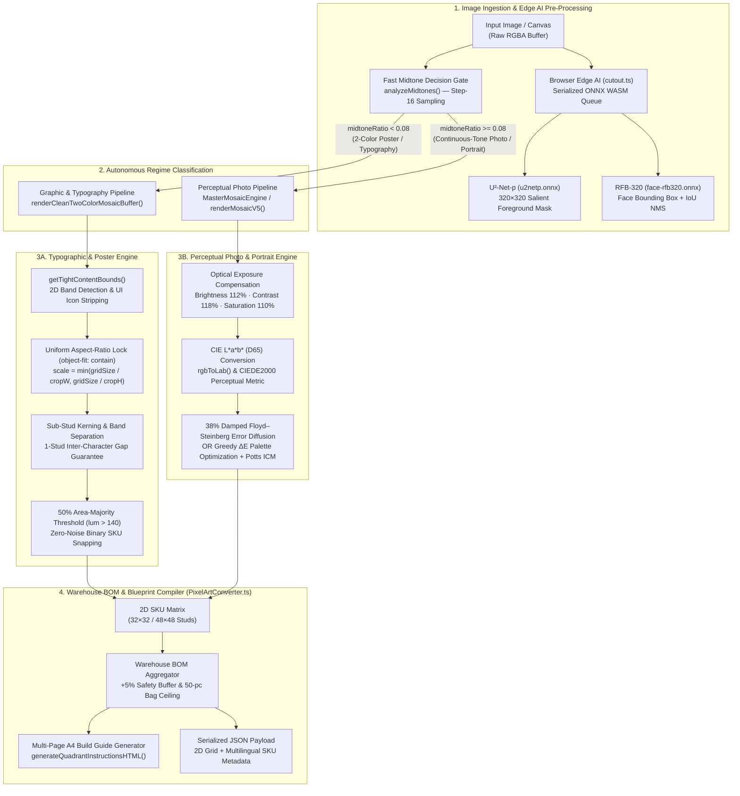

# PLAQA Mosaic Engine — Perceptual Computer Vision, Edge AI & Automated Manufacturing Pipeline

[](https://www.typescriptlang.org/)
[](https://nodejs.org/)
[](https://onnxruntime.ai/)
[](https://sharp.pixelplumbing.com/)

## Executive Summary

**PLAQA Mosaic Engine** is an end-to-end Computer Vision, Edge AI, and physical manufacturing pipeline that transforms arbitrary digital imagery—ranging from high-dynamic-range portraits to typographic posters—into physically buildable, factory-constrained brick mosaics ($32 \times 32$ and $48 \times 48$ stud matrices).

Bridging the gap between digital image processing and physical supply-chain execution requires solving non-trivial engineering constraints:
1. **Constrained Physical Gamut:** Unlike 24-bit sRGB displays ($16.7\text{M}$ colors), physical injection-molded ABS plates/studs are restricted to a discrete warehouse inventory (22 active round-stud SKUs / 97 total factory colors) with non-linear reflectance and zero true mid-tone grays or deep maroons.
2. **Dual-Regime Visual Fidelity:** Continuous-tone portraits require controlled perceptual dithering to preserve skin gradients and fabric folds without introducing color speckle, whereas typographic posters and vector logos require hard binary snapping, content-aware margin trimming, and sub-stud kerning preservation so letterforms never merge or stretch.
3. **Zero-Cost Edge Inference:** Subject segmentation and face detection execute entirely client-side in WebAssembly via serialized ONNX Runtime sessions (`u2netp.onnx` and `face-rfb320.onnx`), eliminating server GPU inference costs and preserving user privacy.
4. **Automated Fulfillment & Blueprint Generation:** Every conversion automatically compiles a warehouse-ready **Bill of Materials (BOM)** with $+5\%$ safety buffer calculations, 50-piece bag quantization, serialized 2D JSON assembly matrices, and multi-page A4 print/PDF quadrant build guides.

---

## System Architecture & Pipeline Flow



---

## Key Engineering Features

### 1. Autonomous Midtone Decision Gate (`analyzeMidtones`)
Located in `src/lib/MasterMosaicEngine.ts`, the engine inspects every 4th pixel (`step = 16` bytes) in $O(N/4)$ time to compute ITU-R BT.601 luminance ($Y = 0.299R + 0.587G + 0.114B$):
* Pixels with $Y < 60$ are accumulated into the dark cluster; pixels with $Y > 180$ are accumulated into the light cluster.
* If the intermediate midtone ratio satisfies $\text{midtoneRatio} = 1 - \frac{N_{\text{dark}} + N_{\text{light}}}{N_{\text{sampled}}} < 0.08$, the image is deterministically routed to the **2-Color Graphic/Poster Pipeline**, mapping the dark and light cluster centroids to their nearest physical warehouse SKUs in CIE $L^*a^*b^*$ space.
* Otherwise ($\text{midtoneRatio} \ge 0.08$), it routes to the **Perceptual Photo Pipeline**.

### 2. Typographic & Vector Poster Engine (`renderCleanTwoColorMosaicBuffer`)
Standard downsamplers destroy text legibility on low-resolution ($32 \times 32$ or $48 \times 48$) grids due to anti-aliasing blur, aspect-ratio distortion, and stroke dilation. The graphic engine solves this via four deterministic stages:
* **Content-Aware Bounding Box & Artifact Filtering (`getTightContentBounds`):** Scans horizontal luminance projections to isolate active content bands while automatically rejecting border-clipped slivers ($< 4\%$ image height at $y \le 2$ or $y \ge H - 2$) and isolated corner UI overlays ($< 3\%$ of the dominant band's foreground pixel mass), then applies a $6\%$ visual margin.
* **Strict Uniform Scaling (`object-fit: contain`):** Prevents independent horizontal/vertical stretching via a single scale factor:
  $$\text{scale} = \min\left(\frac{\text{gridSize}}{\text{cropW}}, \frac{\text{gridSize}}{\text{cropH}}\right)$$
  centering the rendered bounding box on the square baseplate and filling surrounding padding with the detected background SKU.
* **2D Sub-Stud Kerning & Row Separation:** Segments each horizontal text band into discrete character bounding boxes (`cSpans`), enforcing a minimum 1-stud horizontal kerning gap (`cSpans[j].gxStart = Math.max(cSpans[j].gxStart, cSpans[j - 1].gxEnd + 1)`) and re-centering the character group around its natural optical axis (`origCenter`).
* **Balanced 50% Area-Majority Rule:** Evaluates foreground pixel density within each mapped cell against a $50\%$ majority threshold (`lum > 140`), preserving internal letter counters (`A`, `O`, `R`) and eliminating anti-aliasing gray/blue noise studs.

### 3. Perceptual CIE $L^*a^*b^*$ Quantization & 38% Damped Error Diffusion
* **Exact D65 Colorimetry (`rgbToLab`, `labToRgb`, `ciede2000`):** Implements inverse sRGB companding ($\gamma = 2.4$ above $0.04045$), CIE XYZ (D65 reference white $X_n = 0.95047, Y_n = 1.00000, Z_n = 1.08883$), and CIEDE2000 ($\Delta E_{00}$) with lightness, chroma, and hue-rotation weighting.
* **38% Controlled Floyd–Steinberg Micro-Dithering (`convertDownsampledBufferToMasterMosaic`):** Applies pre-quantization optical exposure normalization (`brightness(112%) contrast(118%) saturate(110%)`) followed by a damped $0.38$ Floyd–Steinberg kernel ($\frac{7}{16}, \frac{3}{16}, \frac{5}{16}, \frac{1}{16}$). Full $100\%$ error diffusion creates chaotic checkerboard noise on coarse $32 \times 32$ grids; damping diffusion to $38\%$ achieves smooth 3D facial shading and fabric fold transitions while keeping flat backgrounds solid.
* **V5 Perceptual Engine (`src/lib/mosaic5.ts` & `src/lib/mosaic.ts`):** Features bilateral Lab filtering, 2-means per-cell stroke/highlight rescue, greedy importance-weighted palette reduction (`optimizePalette`), and Iterated Conditional Modes (ICM / Potts model) spatial smoothing with connected-component island cleanup (`consolidate`).

### 4. Client-Side Edge AI (`src/lib/cutout.ts`)
* **Serialized WASM Execution Queue:** Because `onnxruntime-web` executes single-threaded in WebAssembly, `serial()` chains all inference promises sequentially to prevent concurrent session race conditions while the user drags the crop viewport.
* **Salient Object Segmentation (`foregroundMask`):** Normalizes $320 \times 320$ RGBA buffers with ImageNet mean/std and runs `u2netp.onnx` to produce a normalized $[0, 1]$ foreground probability map for background softening or solid-stud replacement (`composite`).
* **Face Detection & Auto-Framing (`detectFace`):** Runs `face-rfb320.onnx` at $320 \times 240$, filters confidence $\ge 0.90$, applies IoU Non-Maximum Suppression ($\text{IoU} < 0.35$), and automatically suggests head-and-shoulders portrait framing or detects group crowds ($\text{count} > 2$).

### 5. Warehouse BOM & Multi-Page A4 Blueprint Compiler (`src/lib/PixelArtConverter.ts`)
* **Inventory-Backed SKU Mapping (`createWarehousePalette`):** Maps quantized cells to verified warehouse SKUs (`ROUND_STUD_STOCK` and `PALETTE_SEED`), attaching alphanumeric build symbols (`1`–`9`, `A`–`Z`) and multilingual labels (English, Arabic, Chinese).
* **Supply-Chain Packaging Math:** Computes exact stud counts, applies a configurable $+5\%$ safety buffer ($\lceil \text{count} \times 1.05 \rceil$), and calculates discrete 50-piece warehouse bags to pick ($\lceil \text{countWithBuffer} / 50 \rceil$).
* **A4 Print-Ready Assembly Blueprints (`generateQuadrantInstructionsHTML`):** Generates a 5-page self-contained HTML/CSS print document (`@page { size: A4 portrait; margin: 12mm; }`) comprising Page 1 (Master Warehouse BOM table) and Pages 2–5 (Quadrants 1–4 magnified $16 \times 16$ symbol grids with per-quadrant color legends and contrast-adaptive symbol badges).

---

## Tech Stack & Dependencies

| Layer | Technology / Library | Version | Purpose |
| :--- | :--- | :--- | :--- |
| **Language** | TypeScript | `^5.6.3` | Strict-typed ES2022 algorithmic core & React UI components |
| **Runtime & CLI** | Node.js / `tsx` | `^22.0.0` / `^4.19.2` | High-speed CLI execution and automated verification suites |
| **Image Processing** | `sharp` (libvips) | `^0.33.5` | Fast image decoding, Lanczos3 resampling, raw buffer extraction & SVG rasterization |
| **Edge AI / ML** | `onnxruntime-web` | `1.20.1` | In-browser WebAssembly execution of `u2netp.onnx` and `face-rfb320.onnx` |
| **Frontend UI** | React / Next.js | 18+ / 15 | Interactive Custom Studio (`custom-studio.tsx`) & 2D Canvas renderer (`mosaic-canvas.tsx`) |

---

## Project Structure

```text
plaqa-mosaic-engine/
├── cli/
│   ├── convert.ts                   # CLI runner for the V5 perceptual engine (styles, backgrounds, ΔE stats)
│   ├── run_mosaic_converter.ts      # Batch CLI benchmark runner for the Master Mosaic Engine (32×32)
│   ├── run_pixel_art_converter.ts   # End-to-end CLI generating PNG previews, JSON matrices, and A4 HTML guides
│   └── run_keep_calm.ts             # CLI runner for 48×48 typographic poster conversion & BOM verification
├── models/
│   ├── u2netp.onnx                  # Portable U²-Net salient foreground segmentation model (4.6 MB, Apache-2.0)
│   ├── face-rfb320.onnx             # Ultra-Light RFB-320 face detection model (1.2 MB, MIT)
│   └── README.txt                   # Model provenance and open-source license attributions
├── samples/                         # Benchmark evaluation dataset (portraits, calligraphy album art, product shots)
├── src/
│   ├── components/
│   │   ├── custom-studio.tsx        # React interactive studio (auto-face crop, ONNX analysis, per-stud pixel editor)
│   │   └── mosaic-canvas.tsx        # Hardware-accelerated HTML5 Canvas brick/stud renderer with guide numbering
│   └── lib/
│       ├── MasterMosaicEngine.ts    # Core dual-mode engine (midtone gate, 2-color typography & 38% photo dithering)
│       ├── PixelArtConverter.ts     # Warehouse SKU hydration, +5% BOM calculator, and 5-page A4 HTML guide builder
│       ├── UniversalMosaicEngine.ts # Unified TypeScript facade exporting MasterMosaicEngine primitives
│       ├── mosaicConverter.ts       # Canvas-to-matrix adapter for legacy studio integration
│       ├── mosaic5.ts               # V5 multi-stage classifier & perceptual photo/graphic quantization pipeline
│       ├── mosaic.ts                # CIE L*a*b* D65 math, CIEDE2000, greedy palette optimizer & Potts ICM smoothing
│       ├── palette-seed.ts          # 97-color factory catalog (part 3024) with EN/AR/ZH names & RGB calibration
│       └── cutout.ts                # Serialized onnxruntime-web inference wrapper for U²-Net-p and RFB-320
├── tests/
│   ├── verify_pipeline.ts           # System audit suite: CIE D65 roundtrip math, zero-noise & calligraphy benchmarks
│   ├── test_pixel_art_converter.ts  # Verification suite for BOM math (+5% buffer, bag counts) & 5-page A4 output
│   └── test_graphic_mode.ts         # Verification suite for auto-detection gate and 2-color poster kerning
├── package.json                     # Project scripts and dependency manifest
└── tsconfig.json                    # Strict ES2022 TypeScript compiler configuration
```

---

## Installation & Usage

### 1. Prerequisites & Environment Setup
Ensure **Node.js 20+** (recommended: v22 LTS) is installed. Clone the repository and install dependencies:

```bash
git clone https://github.com/BravWayne/plaqa-mosaic-engine.git
cd plaqa-mosaic-engine
npm install
```

### 2. Environment Variables (`.env`)
The core engine and CLI tools run locally with zero external API dependencies. If integrating with custom output directories or external storage, create a `.env` file in the project root:

```env
# Optional: Override default output directory for generated previews and A4 build guides
OUTPUT_DIR=./test-output
```

### 3. Running the Verification & Audit Test Suite
Execute the full automated verification suite (CIE D65 colorimetry roundtrip checks, typography preservation, BOM math validation, and graphic/photo mode routing):

```bash
npm test
```

Run static TypeScript type checking across all modules:

```bash
npx tsc --noEmit
```

### 4. Running the CLI Converters

**A. Universal Master Engine Batch Conversion (Photos & Portraits):**
```bash
npm run run-mosaic
```
Processes sample portraits and album art through the automatic midtone decision gate, outputting rendered round-stud PNG previews to `./test-output/` and printing active SKU distributions to the terminal.

**B. Full Warehouse Pipeline (PNG Preview + 2D JSON Matrix + 5-Page A4 HTML Build Guide):**
```bash
npx tsx cli/run_pixel_art_converter.ts
```
Generates:
* `test-output/<name>-pixelart.png` — High-resolution stud preview.
* `test-output/<name>-matrix.json` — Serialized $32 \times 32$ 2D grid and warehouse BOM payload.
* `test-output/<name>-instructions.html` — Printable 5-page A4 assembly blueprint (open in any browser and select **Print → Save as PDF**).

**C. Single-Image CLI Conversion (V5 Engine with Style & Background Controls):**
```bash
npx tsx cli/convert.ts samples/assala.png out.png --style colour --bg keep
npx tsx cli/convert.ts samples/woman.png out-portrait.png --kind portrait
```
Supported flags:
* `--style`: `colour` | `bold` | `mono` | `vintage`
* `--bg`: `keep` | `soft` | `auto`
* `--kind`: `portrait` | `subject` | `scene` | `graphic` (defaults to automatic classification)

---

## License & Attributions
* **Engine & Pipeline Code:** MIT License — Copyright (c) [BravWayne](https://github.com/BravWayne).
* **Pre-Trained ONNX Models:**
  * `u2netp.onnx` ($U^2\text{-Net}$ Portable): Licensed under **Apache-2.0** ([xuebinqin/U-2-Net](https://github.com/xuebinqin/U-2-Net)).
  * `face-rfb320.onnx` (Ultra-Light Fast Generic Face Detector): Licensed under **MIT** ([Linzaer/Ultra-Light-Fast-Generic-Face-Detector-1MB](https://github.com/Linzaer/Ultra-Light-Fast-Generic-Face-Detector-1MB)).
